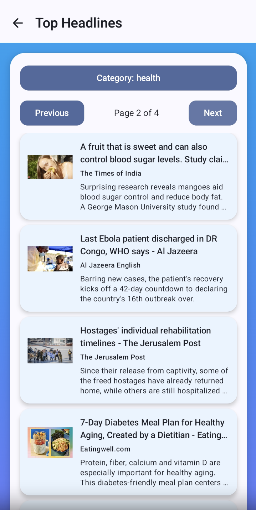
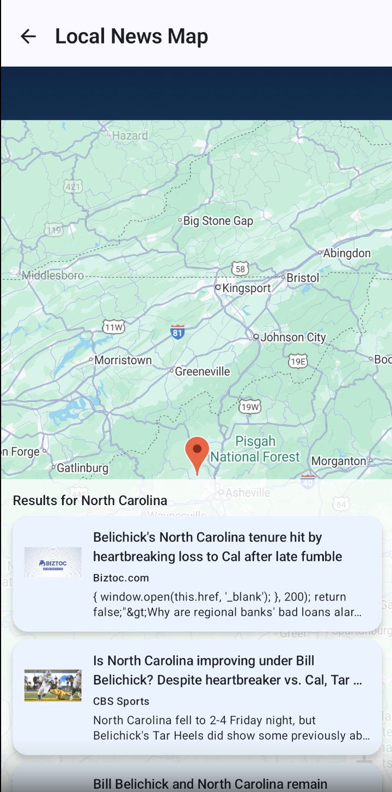

<div align="center">

# 📰 News Explorer: Android News & Local News Map

**Search worldwide news, browse top headlines by category, and long-press anywhere on a map to see what's happening there.**


</div>

---

## Overview

News Explorer is a native Android app built with Kotlin and Jetpack Compose on top of the [NewsAPI](https://newsapi.org/) REST API. Users can search articles by keyword and narrow results to a specific publisher, page through top U.S. headlines by category, or open an interactive Google Map and long-press any location to load news about that place. The app remembers recent choices across sessions: last search, last category, and last map location.

<!-- Screenshots: add images to a /screenshots folder and uncomment.
<p align="center">
  
  
  
  
</p>
-->

## Features

- **Keyword search with source filtering.** Enter a search term, pick a category, and choose from that category's publishers, or skip straight to results from every source. Results are sorted by most recent.
- **Top headlines by category.** Browse U.S. headlines across business, entertainment, general, health, science, sports, and technology, with page-by-page navigation based on the API's total result count.
- **Local news map.** Long-press anywhere on a Google Map to drop a marker. The app reverse-geocodes the location (state for U.S. points; city, county, or country elsewhere) and loads articles that mention it in their headline.
- **Rich article cards.** Each card shows a thumbnail loaded asynchronously with Coil, the headline, source, and summary. Tap a card to open the full article in the browser.
- **State persistence.** The app saves the last username, search term, headline category, and map position and zoom with SharedPreferences, and restores them on the next launch.
- **Login screen with input validation.** The Login button stays disabled until the username is at least 5 characters and the password at least 8. Errors show inline as you type.
- **Resilient networking.** API calls run off the main thread with Kotlin Coroutines, handle API, HTTP, and network errors, and show friendly empty-state messages.

## Tech Stack

| Layer | Tools |
| --- | --- |
| Language | Kotlin |
| UI | Jetpack Compose, Material 3 |
| Networking | OkHttp (with logging interceptor), `org.json` parsing |
| Maps & location | Google Maps SDK for Android, Maps Compose, Android `Geocoder` |
| Images | Coil (async image loading) |
| Async | Kotlin Coroutines (`LaunchedEffect`, `Dispatchers.IO`) |
| Persistence | SharedPreferences |
| Secrets | Secrets Gradle Plugin (API keys kept out of source) |
| Data source | [NewsAPI](https://newsapi.org/docs) (`/everything`, `/top-headlines`, `/top-headlines/sources`) |

## App Flow

```
Login ──▶ Home
            ├── Search ──▶ Sources (pick category + publisher, or Skip) ──▶ Results ──▶ Article (browser)
            ├── Top Headlines (category dropdown + pagination) ──────────────────────▶ Article (browser)
            └── Map (long-press a location → reverse geocode → local articles) ─────▶ Article (browser)
```

## Project Structure

```
app/src/main/java/firstapp/gwu/newsappproject/
├── MainActivity.kt          # Login screen + input validation
├── MainSearchActivity.kt    # Home: search box, links to Map and Top Headlines
├── SourcesActivity.kt       # Category dropdown + publisher list (/top-headlines/sources)
├── ResultsActivity.kt       # Search results (/everything), optionally filtered by source
├── TopHeadlinesActvity.kt   # Paginated headlines by category (/top-headlines)
├── MapActivity.kt           # Google Map, reverse geocoding, location-based news
└── ui/theme/                # Material 3 colors, typography, theme
```

## Getting Started

### Prerequisites

- Android Studio (recent stable release)
- JDK 11+
- An Android device or emulator running Android 7.0 (API 24) or later, with Google Play services for the map
- A free [NewsAPI key](https://newsapi.org/register)
- A [Google Maps SDK for Android API key](https://developers.google.com/maps/documentation/android-sdk/get-api-key)

### Setup

1. **Clone the repo**
   ```bash
   git clone https://github.com/hadya584/NewsAppProject.git
   cd NewsAppProject
   ```

2. **Add your API keys**
   Create a `secrets.properties` file in the project root. It's gitignored, so your keys never get committed:
   ```properties
   NEWS_API_KEY=your_newsapi_key
   MAPS_API_KEY=your_google_maps_key
   ```
   At build time, the Secrets Gradle Plugin and the app's build script inject these keys. If the file is missing, the build falls back to placeholder values from `local.defaults.properties`.

3. **Build and run**
   Open the project in Android Studio, let Gradle sync, and run the `app` configuration. You can also build from the command line:
   ```bash
   ./gradlew installDebug
   ```

> **Note:** NewsAPI's free Developer plan only allows requests from `localhost` and development builds, and returns articles from roughly the past month.

## What I Learned

- Consuming a REST API directly with OkHttp and parsing JSON responses by hand
- Managing async work and UI state in Compose with `LaunchedEffect` and coroutines
- Integrating Google Maps in Compose, handling map gestures, and reverse geocoding coordinates into searchable place names
- Keeping API keys out of version control with the Secrets Gradle Plugin
- Persisting lightweight user state across sessions with SharedPreferences

---
